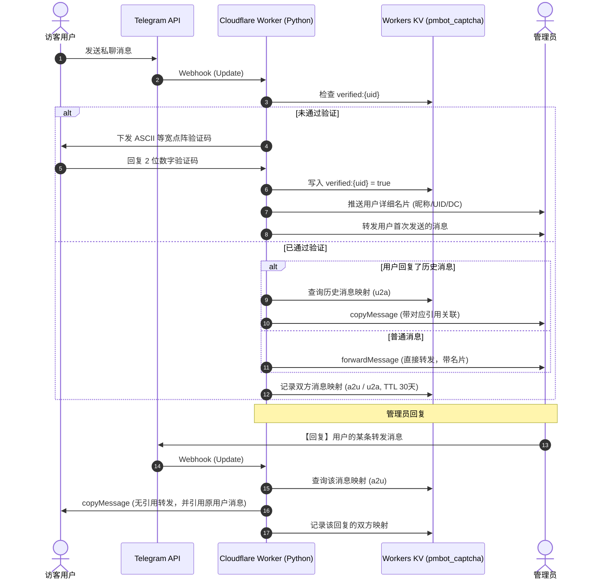

# TG_PMbot 🤖

[](https://workers.cloudflare.com/)
[-3776AB?logo=python&logoColor=white)](https://pyodide.org/)
[](https://opensource.org/licenses/MIT)

轻量、高性能、零成本的 **Telegram 私聊反代/客服转发机器人**。  
基于 **Cloudflare Workers (Python Runtime)** 与 **Workers KV** 架构，无需自备服务器，全球边缘低延迟直连 Telegram。

---

## ✨ 核心特性

- **🔄 双向消息原生转发与引用（Reply）支持**：
  - **对方消息**：通过 `forwardMessage` **直接转发**给管理员，保留对方名片信息与 Telegram 原生来源标签。
  - **管理回复**：管理员在私聊中直接【回复】某条转发消息，Bot 将通过 `copyMessage` **无引用转发**给对方（隐匿管理员真实账号），同时在用户侧精准还原对原消息的引用关联（Quote）。
  - **双向引用保持**：用户若引用回复历史消息，管理员侧同样呈现对应的引用关系。
  - **30 天索引存储**：基于 Workers KV 自动维护双向消息 ID 映射关系，TTL 30 天自动过期，杜绝垃圾数据堆积。
- **🛡️ 创新 ASCII 点阵 Captcha 验证**：
  - 纯 Python 动态生成 $7\times 7$ 点阵字符画（使用 `-` 与 `0` 绘制 2 位随机数）。
  - 使用 Telegram `<pre>` 等宽语法包裹下发，移动端和桌面端排版工整不跑偏。
  - 5 分钟超时控制，通过验证后自动清理验证码消息，保持聊天界面整洁。
- **👤 访客身份名片 (User Info Banner)**：
  - 未验证用户首次通过验证时，在转发其消息前，先向管理员推送结构化名片：
    - **昵称**：使用 `<code>{name}</code>` 包裹，点击即可复制。
    - **用户名**：`@{username}`（无则展示 `null`）。
    - **UID**：使用 `<code>{uid}</code>` 包裹，点击即可复制。
    - **DC（数据中心）**：通过解码用户头像的 Telegram File ID 二进制结构（Base64 URL-safe + RLE 解压缩 + 二进制解包）自动识别其所属数据中心（如 `DC2`、`DC5`），无头像时展示 `null`。
- **🔐 零泄露 Secrets 安全体系**：
  - 代码库中不包含任何敏感 Token 或 UID，配置文件已与密钥完全解耦。
  - 敏感凭据（`BOT_TOKEN`、`ADMIN_UID`、`TG_WEBHOOK_SECRET`）全部采用 Cloudflare Worker Secrets 加密保存。
  - 自动校验 Telegram `X-Telegram-Bot-Api-Secret-Token` 请求头，杜绝外部伪造 Webhook。

---

## 📐 交互架构流程



---

## 🚀 快速部署指南

### 1. 前置准备
- 一个 [Cloudflare](https://dash.cloudflare.com/) 账号并安装 [Wrangler CLI](https://developers.cloudflare.com/workers/wrangler/install-and-update/)：
  ```bash
  npm install -g wrangler
  wrangler login
  ```
- 从 [@BotFather](https://t.me/BotFather) 获取你的 Telegram Bot Token。
- 获取你的 Telegram 账号数字 UID（可通过 [@userinfobot](https://t.me/userinfobot) 查询）。

### 2. 创建 Workers KV 命名空间
在项目根目录运行以下命令创建 KV：
```bash
wrangler kv namespace create pmbot_captcha
```
控制台将输出该 KV 的 `id`，将其填入 `wrangler.toml` 中的 `[[kv_namespaces]]` 区域：
```toml
[[kv_namespaces]]
binding = "pmbot_captcha"
id = "你的_KV_ID"
```

### 3. 配置加密 Secrets
无需在配置文件中编写明文凭据，通过命令行安全注入：
```bash
# 1. 注入 Bot Token
wrangler secret put BOT_TOKEN
# 提示输入时粘贴你的 Token，如：<YOUR_BOT_TOKEN>

# 2. 注入 管理员 UID
wrangler secret put ADMIN_UID
# 提示输入时粘贴你的 UID，如：<YOUR_TELEGRAM_UID>

# 3. 注入 Webhook 鉴权密钥 (可选但强烈推荐)
wrangler secret put TG_WEBHOOK_SECRET
# 输入一段自定义的高强度随机字符串，用于验证请求来自 Telegram
```

### 4. 部署 Worker
执行一键部署：
```bash
wrangler deploy
```
部署成功后，Wrangler 会给出你的 Worker 域名（例如：`https://tg-pmbot.<your-subdomain>.workers.dev`）。

### 5. 绑定 Telegram Webhook
使用 `curl` 或在浏览器访问 Telegram API 设置 Webhook（将 `<BOT_TOKEN>`、`<WORKER_URL>`、`<WEBHOOK_SECRET>` 替换为你的真实值）：
```bash
curl -F "url=https://<WORKER_URL>" \
     -F "secret_token=<WEBHOOK_SECRET>" \
     https://api.telegram.org/bot<BOT_TOKEN>/setWebhook
```
当接口返回 `{"ok":true,"result":true,"description":"Webhook was set"}` 时，即代表配置成功！🎉

---

## 💡 使用说明

### 管理员操作
1. **回复用户**：在 Bot 窗口中，直接**引用回复（Reply）**用户的任何消息，Bot 会自动无缝传递给对方。
2. **状态提示**：
   - 若发送非回复消息，Bot 会提示回复特定消息以确定收件人。
   - 若引用已过期（超过 30 天）的消息，Bot 会友好提示消息无法送达。

### 验证码样式示例
访客向 Bot 发送消息时，将收到类似如下的等宽字符画：
```text
-----000----00000--
----0000---00---00-
--00--00--------00-
-00---00-----0000--
-0000000----00-----
------00---00------
------00---0000000-
```
访客回复 `42` 即可瞬间解锁会话。

---

## 📂 项目结构

```text
TG_PMbot/
├── src/
│   └── entry.py          # Python Worker 核心代码 (处理 Webhook、Captcha、DC 解包、转发)
├── .gitignore            # Git 忽略文件规则
├── LICENSE               # MIT 开源协议
├── README.md             # 项目完整文档
├── wrangler.toml         # Wrangler 配置文件 (不含敏感信息)
└── wrangler.toml.example # 示例配置文件
```

---

## 📜 许可证

本项目基于 [MIT License](LICENSE) 开源发布。
