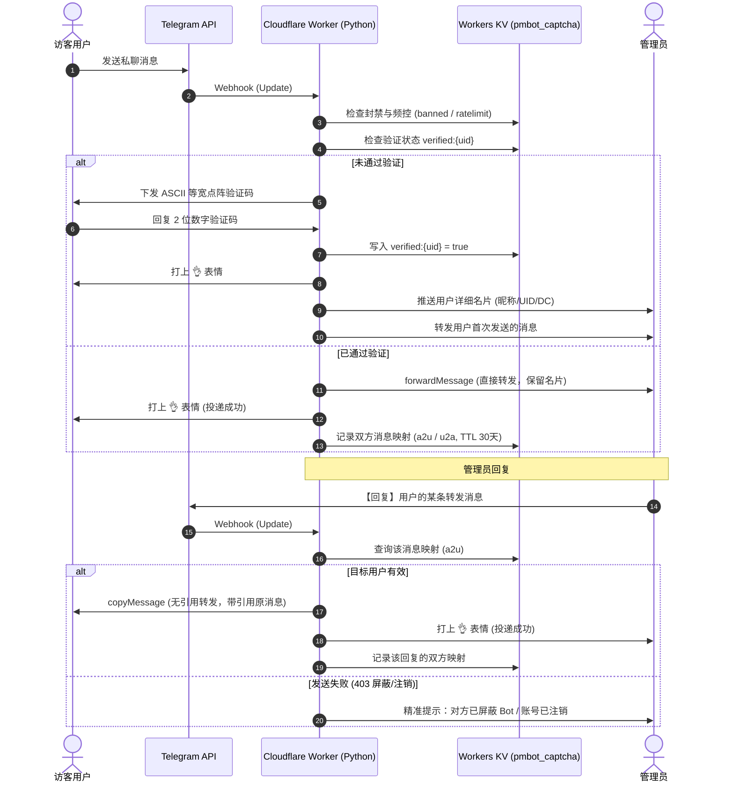

# TG_PMbot 🤖

[](https://workers.cloudflare.com/)
[-3776AB?logo=python&logoColor=white)](https://pyodide.org/)
[](https://opensource.org/licenses/MIT)

轻量、高性能、零成本的 **Telegram 私聊反代/客服转发机器人**。  
基于 **Cloudflare Workers (Python Runtime)** 与 **Workers KV** 架构，无需自备服务器，全球边缘低延迟直连 Telegram。

---

## ✨ 核心特性

- **🔄 双向消息原生转发与引用（Reply）支持**：
  - **访客发消息**：通过 `forwardMessage` **直接转发**给管理员，完整保留对方名片信息、头像与 Telegram 转发来源标签，方便识别对方身份。
  - **管理员回复**：管理员在私聊中直接【回复】某条转发消息，Bot 将通过 `copyMessage` **无引用转发**给对方（隐匿管理员真实账号），同时在用户侧精准还原对原消息的引用关联（Quote）。
  - **双向引用保持**：双方使用 Telegram 的 Reply 功能时，均可在接收端精准看到被引用的原消息。
  - **30 天索引存储**：基于 Workers KV 自动维护双向消息 ID 映射关系，TTL 30 天自动过期，杜绝垃圾数据堆积。
- **👌 原生 Reaction 表情投递反馈**：
  - 消息转发成功后，Bot 自动在原消息上打上 `👌` 表情反应（无需多余提示气泡，体验极度轻量丝滑）。
- **🛡️ 创新 ASCII 点阵 Captcha 验证**：
  - 纯 Python 动态生成 $7\times 7$ 点阵字符画（使用 `-` 与 `0` 绘制 2 位随机数）。
  - 使用 Telegram `<pre>` 等宽语法包裹下发，移动端和桌面端排版工整不跑偏。
  - 5 分钟超时控制，通过验证后自动清理验证码消息，保持聊天界面整洁。
- **👤 访客身份名片 (User Info Banner)**：
  - 未验证用户首次通过验证时，在转发其消息前，先向管理员推送结构化名片：
    - **昵称**：使用 `<code>{name}</code>` 包裹，点击即可复制。
    - **用户名**：`@{username}`（无则展示 `null`）。
    - **UID**：使用 `<code>{uid}</code>` 包裹，点击即可复制。
    - **DC（数据中心）**：通过解码用户头像的 Telegram File ID 二进制结构（Base64 URL-safe + RLE 解压缩 + 二进制解包）自动识别其所属数据中心（如 `DC2`、`DC5`），无头像时展示 `null`。
- **🚫 403 故障识别（屏蔽 vs 注销）**：
  - 管理员发送消息失败时，智能细分并明确告警：
    - `bot was blocked by the user` $\rightarrow$ 提示“对方已将 Bot 屏蔽，消息无法送达”。
    - `user is deactivated` $\rightarrow$ 提示“对方账号已注销，消息无法送达”。
- **🔨 黑名单管理 (`/ban` & `/unban`)**：
  - 支持回复消息或指定 UID 进行封禁/解封。
  - 支持填写封禁理由（如 `/ban 广告骚扰`）；若不填理由则只发送默认封禁提醒。
  - 被封禁用户的后续消息将在边缘入口直接拦截，不再打扰管理员。
- **⏱️ 消息频率限制 (Rate Limiting)**：
  - 边缘级滑动窗口限频（10 秒最多 5 条消息），超限自动提示并拦截，有效抵御脚本刷屏。
- **🧰 工具箱命令 (`/info`)**：
  - 管理员回复任意用户消息发送 `/info`，随时重新调出该用户的详细资料、数据中心与账号状态。
- **🔐 零泄露 Secrets 安全体系**：
  - 代码库中不包含任何敏感 Token 或 UID，配置文件已与密钥完全解耦。
  - 敏感凭据（`BOT_TOKEN`、`ADMIN_UID`、`TG_WEBHOOK_SECRET`）全部采用 Cloudflare Worker Secrets 加密保存。
  - 自动校验 Telegram `X-Telegram-Bot-Api-Secret-Token` 请求头，杜绝外部伪造 Webhook。

---

## 📐 交互架构流程



---

## 📋 BotFather 指令设置清单

在 [@BotFather](https://t.me/BotFather) 中使用 `/setcommands` 命令，复制粘贴以下文本即可配置快捷指令提示：

```text
start - 开始使用并进行人机验证
help - 查看帮助说明与管理员指令
ban - 封禁用户 (仅管理员)
unban - 解封用户 (仅管理员)
info - 查看用户完整名片与状态 (仅管理员)
```

---

## 🚀 快速部署指南

本项目支持 **GitHub Actions 自动化 CI/CD 持续部署**（推荐）与 **本地 Wrangler CLI 手动部署** 两种方式。

---

### 方案 A：GitHub Actions 自动持续部署（推荐）

通过 GitHub Actions，您只需向仓库推送代码或手动点击执行，即可自动完成部署并将密钥安全同步至 Cloudflare Workers。

#### 1. 前置准备
- 准备一个 [Cloudflare](https://dash.cloudflare.com/) 账号。
- 从 [@BotFather](https://t.me/BotFather) 创建 Bot 并获取 `BOT_TOKEN`。
- 获取您的 Telegram 账号数字 UID（可通过 [@userinfobot](https://t.me/userinfobot) 发送 `/start` 查看）。
- 在 Cloudflare 控制台创建 Workers KV：
  - 进入 **Workers 和 Pages** -> **KV** -> **创建命名空间**，名称命名为 `pmbot_captcha`。
  - 获取生成的命名空间 ID，并在仓库中的 `wrangler.toml` 文件中将 `id = "..."` 替换为您自己的 KV ID。

#### 2. 配置 GitHub 仓库 Secrets
在您的 GitHub 仓库页面，依次点击 **Settings** -> **Secrets and variables** -> **Actions** -> **New repository secret**，添加以下密钥：

| Secret 变量名 | 必填 | 说明与获取路径 |
| :--- | :---: | :--- |
| `CF_API_TOKEN` | **是** | Cloudflare API Token。获取路径：Cloudflare 控制台 -> **我的个人资料 (Profile)** -> **API 令牌** -> **创建令牌** -> 选择 **“编辑 Cloudflare Workers”** 模板创建。 |
| `CF_ACCOUNT_ID` | **是** | Cloudflare 账户 ID。获取路径：Cloudflare 控制台 -> **Workers 和 Pages** 概览页 -> 右侧侧边栏查看 **“账户 ID”**。 |
| `BOT_TOKEN` | **是** | Telegram 机器人的 Token（格式如 `123456789:ABCdef...`）。工作流会自动将其同步至 Worker 的加密环境变量。 |
| `ADMIN_UID` | **是** | 管理员的数字 UID（纯数字，如 `1100381322`）。工作流会自动将其同步至 Worker 的加密环境变量。 |
| `TG_WEBHOOK_SECRET` | 否 | Webhook 鉴权防伪密钥（推荐），填入一段自定义的高强度随机字符串。若配置，工作流会自动同步至 Worker。 |

> [!NOTE]
> 工作流同时兼容 `CF_API_TOKEN` / `CLOUDFLARE_API_TOKEN` 以及 `CF_ACCOUNT_ID` / `CLOUDFLARE_ACCOUNT_ID`。

#### 3. 触发自动化部署
- **自动触发**：推送代码至 `main` 分支（当修改了 `src/**`、`wrangler.toml` 或工作流文件时）将自动触发构建与发布。
- **手动触发**：进入仓库 **Actions** 标签页 -> 选择 **Deploy Cloudflare Worker** -> 点击 **Run workflow** 即可随时手动触发。
- 工作流会自动执行 `wrangler deploy` 部署脚本，并按需执行 `wrangler secret put` 自动更新 Worker 环境变量。

---

### 方案 B：本地 Wrangler CLI 手动部署

如果您更倾向于在本地终端手动操作，可按照以下步骤部署：

#### 1. 前置准备
```bash
npm install -g wrangler
wrangler login
```

#### 2. 创建 Workers KV 命名空间
```bash
wrangler kv namespace create pmbot_captcha
```
控制台将输出该 KV 的 `id`，将其填入 `wrangler.toml` 中的 `[[kv_namespaces]]` 区域：
```toml
[[kv_namespaces]]
binding = "pmbot_captcha"
id = "你的_KV_ID"
```

#### 3. 配置加密 Secrets
通过命令行安全注入敏感凭据（无需写入配置文件）：
```bash
# 1. 注入 Bot Token
wrangler secret put BOT_TOKEN

# 2. 注入 管理员 UID
wrangler secret put ADMIN_UID

# 3. 注入 Webhook 鉴权密钥 (可选但强烈推荐)
wrangler secret put TG_WEBHOOK_SECRET
```

#### 4. 部署 Worker
```bash
wrangler deploy
```
部署成功后，控制台会输出 Worker 分配的域名（例如：`https://tg-pmbot.<your-subdomain>.workers.dev`）。

---

### 5. 绑定 Telegram Webhook（无论使用方案 A 还是方案 B，均需执行一次）

部署成功获得 Worker URL 后，使用 `curl` 向 Telegram 官方接口注册 Webhook（将 `<BOT_TOKEN>`、`<WORKER_URL>`、`<WEBHOOK_SECRET>` 替换为实际值）：
```bash
curl -F "url=https://<WORKER_URL>" \
     -F "secret_token=<WEBHOOK_SECRET>" \
     https://api.telegram.org/bot<BOT_TOKEN>/setWebhook
```
> 若未设置 `TG_WEBHOOK_SECRET`，可省略 `-F "secret_token=..."` 参数。

接口返回 `{"ok":true,"result":true,"description":"Webhook was set"}` 时，即代表机器人对接完成！🎉

---

## 💡 管理员操作指南

1. **回复用户**：在 Bot 窗口中，直接**引用回复（Reply）**用户的任意消息，Bot 会自动无缝传递给对方。
2. **封禁用户**：
   - 快捷回复封禁：直接回复某条转发消息输入 `/ban`（默认提示）或 `/ban 广告刷屏`（带理由）。
   - 指定 UID 封禁：输入 `/ban 123456789 广告刷屏`。
3. **解封用户**：回复消息发送 `/unban`，或输入 `/unban 123456789`。
4. **查阅资料**：回复某条消息发送 `/info`，随时查询该用户 UID、昵称、用户名、DC 节点与封禁状态。

---

## 📂 项目结构

```text
TG_PMbot/
├── .github/
│   └── workflows/
│       └── deploy-worker.yml # GitHub Actions 自动部署与密钥同步工作流
├── src/
│   └── entry.py              # Python Worker 核心代码 (含 Captcha、DC 解码、双向映射、Reaction、403识别、Ban)
├── .gitignore                # Git 忽略规则 (防误传本地缓存)
├── LICENSE                   # MIT 开源协议
├── README.md                 # 项目完整文档
├── wrangler.toml             # Wrangler 生产部署配置 (无敏感明文)
└── wrangler.toml.example     # 开源示例配置文件
```

---

## 📜 许可证

本项目基于 [MIT License](LICENSE) 开源发布。
